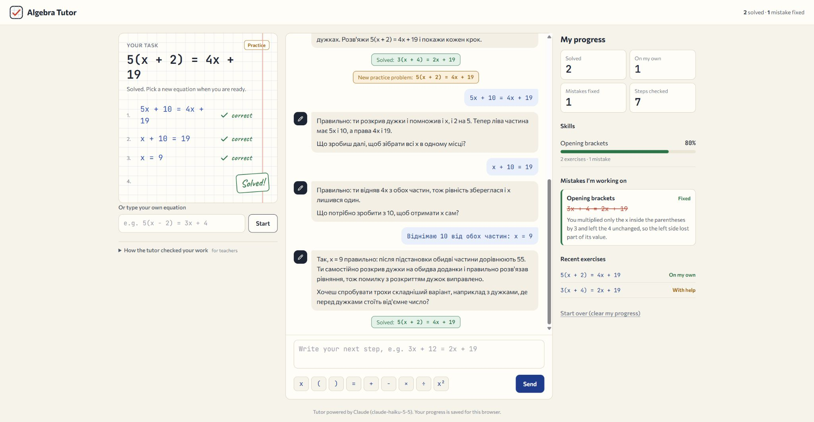

# AI Math Tutor

A web-based algebra tutor for school students. It checks the student's work **line by line**, finds the *reasoning* error behind a wrong step, and guides the student with questions instead of giving the answer. Then it gives a similar practice problem to confirm the student understood. Progress (exercises, mistakes, skill mastery) is saved for each student.

Built with Node.js (no framework) and Claude through the official Anthropic SDK, using tool use. The default model is Claude Haiku 5.5 (`claude-haiku-5-5`); `TUTOR_MODEL` can select another compatible Claude model available to your API key.

## Assignment coverage

1. **Interactive AI tutor:** a web chat, an equation notebook and a progress view, backed by the real Claude API.
2. **Reasoning error detection:** each algebra step can be checked against the previous valid line, with a report of how each side changed. The assignment's distribution error is identified and recorded as a misconception.
3. **Adaptive teaching:** model-generated guiding questions, explanations in the student's language and increasing levels of help. Operational error/refusal notices are fixed text; the teaching dialogue is not scripted.
4. **Personalized practice:** after the original exercise is solved, the tutor assigns a related problem with different numbers. Independent completion of that linked practice verifies the earlier mistake as fixed.
5. **Progress tracking:** completed exercises, checked steps, reasoning mistakes and skill mastery persist per browser student profile. An unfinished notebook survives a page reload and server restart.

The acceptance scenario is below. The architecture and Web/iOS/Android scaling plan are documented in the technical sections. Source code: [F-Andersen/AI-Math-Tutor](https://github.com/F-Andersen/AI-Math-Tutor).

## Demo and delivery

**[Open the live demo](https://aimath.130.61.111.249.sslip.io/)**

The demo runs on the project owner's Oracle Cloud server over HTTPS. The API key stays on the server. You can also run the project locally using the instructions below.



Production screenshot captured on 13 November 2026 during manual acceptance testing. The displayed algebra work is synthetic test data, not a real student's notebook.

## Run it

Requires Node 22.9+.

```bash
npm install
npm start
```


Open http://localhost:3000. The tutor needs an Anthropic API key in the `ANTHROPIC_API_KEY` environment variable of the server process. When hosting, set it in the platform's secret / environment settings. For local work you can instead create a file named `.env` in the project folder with one line, `ANTHROPIC_API_KEY=<your key>`: the npm scripts load it if it exists, and `.gitignore` keeps it out of git. See [Security](#security).

| Command | What it does |
|---|---|
| `npm test` | Algebra engine, tutor tools, tool loop (against a stub API) and HTTP server tests. No key needed |
| `npm run scenario` | Runs the assignment's test scenario in the terminal against the real model |
| `npm run dev` | Starts the server and restarts it when files change |

Optional environment variables: `TUTOR_MODEL` (default `claude-haiku-5-5`), `TUTOR_EFFORT` (`low` / `medium` / `high`, default `medium`), `PORT` (default 3000), `DATA_DIR` (default `./data`), `TRUST_PROXY=1` (set it when the server runs behind a reverse proxy such as nginx, so rate limits use the real client address from `X-Forwarded-For`), `MESSAGES_PER_ADDRESS` (default 150 tutor messages per address per 5 minutes).

There is no build or transpilation step: the server and browser run the checked-in JavaScript directly. Use `npm ci` instead of `npm install` for a reproducible installation from `package-lock.json`.

In the UI, pick **Try the demo mistake**. It starts `3(x + 4) = 2x + 19` and fills in the student's wrong line `3x + 4 = 2x + 19`. Press Send and continue the dialogue.

## Test scenario: what happens

1. The student sends `3x + 4 = 2x + 19`.
2. The tutor calls `check_step("3(x + 4) = 2x + 19", "3x + 4 = 2x + 19")`. The engine returns: **not equivalent** (the solution changes from x = 7 to x = 15). The left side changed from `3x + 12` to `3x + 4` (a change of −8), and the right side is unchanged.
3. From that report the tutor names the misconception (*the 3 was multiplied by x but not by 4: distributive property*) and logs it with `record_mistake`. The student sees the line marked as a wrong step.
4. The tutor does **not** show the correct line. It asks a guiding question, such as "what does 3(x + 4) mean — how many 4s are there?". If the student stays stuck, help increases in steps: point to the location, then ask about the rule, then show the rule on a different example, and only as a last resort reveal the step.
5. The student fixes the line. Each later line is checked the same way. When the student gives `x = 7`, `check_answer` confirms it by substitution and `complete_exercise` records it as solved "with help". The server will not record "independent" for an exercise with a logged mistake.
6. The tutor calls `assign_practice_problem` with a new problem of the same structure, such as `4(x + 3) = 3x + 20`, linked to the logged mistake. The server checks that the problem can be solved and is not one the student has already seen.
7. If the student solves the practice problem with no mistakes, the original mistake is marked **fixed**, and mastery of `distributive_property` goes up.

## Technical approach

```
Browser (public/)  ──HTTP/JSON──  Node server (src/server.js)
                                   ├─ tutor/agent.js   Claude tool loop (Messages API)
                                   ├─ tutor/tools.js   7 tools the model can call
                                   ├─ math/engine.js   deterministic algebra checker
                                   └─ store.js         per-student progress (JSON file)
```

**The model teaches; deterministic code checks the math.** LLMs make arithmetic slips and can agree with a wrong student. So every judgment about correctness comes from `math/engine.js`, a small parser and solver for one-variable polynomial equations with exact fractions (BigInt). It does more than compare final answers:

- `check_step` compares the previous line with the new line: is the solution set preserved, which transformation was used (rewrite, the same term added to both sides, both sides multiplied by k, or *invalid: sides changed by different amounts*), and how each side's value changed. This report shows **where** the reasoning broke, which the tutor needs to name the misconception.
- `check_answer` substitutes the student's value and shows both sides (57 vs 49 for x = 15).
- `solve_equation` gives the tutor the solution for its own reference.

The engine never guesses: if it cannot verify a step (powers above 2), it says so instead of calling a correct step wrong. It also reads the Cyrillic letters х and у as the variables x and y, and `X` as `x`, because that is what Ukrainian and phone keyboards produce.

**Teaching logic is model-driven, not scripted.** The system prompt ([src/tutor/prompt.js](src/tutor/prompt.js)) sets the teaching approach: verify every line, diagnose the misconception, ask one question at a time, increase help in steps, and assign a practice problem after a correction. The model decides when to call each tool, what to ask and how to personalise the explanation. Teaching replies are generated by the model. A collapsible "How the tutor checked your work" panel shows operation names and verification status for each turn without exposing private calculations.

**Progress tracking is tied to verified tool calls.** Progress changes only through tool calls (`record_mistake`, `complete_exercise`, `assign_practice_problem`, `start_exercise`), and the server checks them: an exercise cannot be completed with a wrong final answer, a practice problem must be solvable and new to the student, the same wrong line is logged as one mistake, and an exercise with a logged mistake is never counted as independent. Only lines the student actually wrote are added to their notebook, so a line the tutor checks for itself can never show up there as a hint. A mistake counts as *fixed* only when a practice problem linked to it is solved independently. Mastery per skill is an exponential moving average (independent = 1, with help = 0.5, answer shown = 0). At the start of a session the tutor gets a short profile of the student's past mistakes, so it can personalise from the first message. An unfinished exercise is resumed after a page reload, with the lines already checked.

**Claude API details.** Adaptive thinking with `effort: medium`. The system prompt and tool list never change between requests, so they are prompt-cached. The exercise and student profile are sent as mid-conversation `system` messages, separate from the student's text, so a student cannot impersonate them. History is append-only and keeps full content blocks so thinking blocks stay valid. A failed or refused turn is rolled back to the last valid point. Server-side refusal fallbacks are switched on automatically only for models that support them (Opus 5.x, Sonnet 5.5, Fable); Haiku has none.

**Completion and recovery.** A practice problem is rejected while the current exercise is active; a rejected call leaves its notebook intact and is returned to the model as a tool error so it can continue teaching. `complete_exercise` requires the student to state the final value in their current message (a bare number/fraction or `x = value`, including within prose), and verifies it against the original equation. The same message cannot complete a practice problem just assigned by the tutor, even if both exercises have the same answer. Tools run against a draft: progress, mastery, the active exercise and conversation history are committed together only after a nonempty `end_turn` reply. API failures, refusals, truncated/context-limited output, empty replies and the tool-loop limit discard the draft. Incomplete turns return an explicit retry error instead of a generic successful reply. While a turn is pending, mutations from other sessions for that student, resets and new sessions receive 409; they can be retried once it finishes.

`start_exercise` can start a chat equation when no exercise is active, or acknowledge the current exercise. It cannot replace an unfinished exercise, even if the proposed equation appears in the student's message: that could be an incorrect intermediate line. To switch mid-exercise, the student uses the existing new equation form or sample buttons (`/api/exercise`), which explicitly abandon the previous exercise.

The stub tests cover premature practice attempts, the completion bypass, failure after completion and practice assignment, saved progress after rollback, retries without duplicate mastery, and competing HTTP requests. These deterministic tests verify state handling, not the frequency of premature tool calls or the teaching quality of the live model. `npm run scenario` uses the paid API and is a separate opt-in check.

## Server deployment

The current demo runs on the existing Oracle Cloud Ubuntu server in a dedicated `ai-math-tutor` Docker container, using Node 22.23.5 and restart policy `unless-stopped`. Nginx serves its own HTTPS hostname and proxies to `127.0.0.1:18100`. Progress persists through a separate host directory, `/var/lib/ai-math-tutor`, mounted at `/data`. Other applications on the server keep their own containers and hostnames. No server credentials are kept in this repository.

For a native Node deployment on another host, or when moving the demo:

1. Install Node 22.9+ and copy/clone the source into a dedicated application directory. Run `npm ci --omit=dev` there.
2. Configure `ANTHROPIC_API_KEY` securely on that server. Set `DATA_DIR` to a persistent writable directory outside the application release directory, and choose a free local `PORT`. Do not publish `.env` or reuse real student data for the demo.
3. Run `npm start` under the host's service manager with the application directory as its working directory and automatic restart enabled. Use `npm run dev` only for local development.
4. Route the public HTTPS domain to that application port through the server's reverse proxy. Keep the application port private to the proxy. Set `TRUST_PROXY=1` only when that proxy overwrites incoming forwarding headers. Its response timeout must accommodate a complete tutor tool loop.
5. Verify the public page, `/api/health` (`ai_configured: true`), the mistake/correction/practice flow and progress after reload. Then add the actual public URL to **Demo and delivery** above.

This is a prototype: there is no account authentication, student identity is stored in the browser, conversation text is held in memory, and progress uses a local JSON file. Production authentication, a shared database and horizontally scalable sessions are described in the scaling plan. The algebra engine supports one-variable polynomial work and exact fractions; systems and general symbolic algebra are outside this prototype. Model wording and tool choices remain probabilistic, so successful live checks do not establish a zero error rate.

## Verification

Final local verification on 13 November 2026, using Node 24.14.1 and `@anthropic-ai/sdk` 1.8.0:

- `npm test`: 43 tests passed, including the HTTP regression for private tool traces, transaction rollback, retry, competing sessions and Cyrillic variables.
- A clean temporary source copy, containing no `.env` or real API credentials, installed successfully with `npm ci --ignore-scripts --no-audit --no-fund --offline` and passed the same 43 tests.
- `node --check`: all 13 JavaScript source, browser, scenario and test files passed. This repository has no separate build or lint command.
- `npm run scenario`: the real Haiku integration completed the original exercise with guidance and the practice independently; the misconception was marked fixed. Totals: 2 completed exercises, 1 independent completion, 1 mistake found/fixed, 7 checked steps and 80% skill mastery.
- Chrome UI, Ukrainian dialogue and Cyrillic `х`: wrong expansion, guiding question, correction, final answer, linked practice and independent practice completion all worked. The unfinished notebook survived reload, and completed progress remained after a later reload.
- At 320 px, the page had no horizontal overflow and the Lesson/My progress tabs worked with the keyboard. No browser console errors or warnings were observed during this check.

### Manual production acceptance test

Performed in Chrome on **[the public HTTPS demo](https://aimath.130.61.111.249.sslip.io/)** on 13 November 2026, using only synthetic algebra work. Result: **PASS for the tested flow**.

1. The page loaded successfully and `/api/health` returned HTTP 200 with `ai_configured: true` and model `claude-haiku-5-5`.
2. Started `3(х + 4) = 2х + 19` and submitted the deliberate mistake `3х + 4 = 2х + 19`. The notebook marked it incorrect, the misconception was recorded, and the tutor asked a guiding question without revealing the answer or assigning practice early.
3. Reloaded the page. The unfinished exercise and its incorrect notebook line remained available.
4. Submitted `3х + 12 = 2х + 19`, `х + 12 = 19`, then `х = 7`. Corrected steps were accepted, and the original exercise was completed **with help**.
5. Only after completion, the tutor assigned `5(x + 2) = 4x + 19`. Solved it using `5х + 10 = 4х + 19`, `х + 10 = 19`, then `х = 9`. Practice was completed **independently** and the linked mistake became **Fixed**.
6. Verified totals of 2 completed exercises, 1 independent completion, 1 mistake fixed, 7 checked steps and 80% skill mastery. A second reload preserved those totals, mastery and exercise history.
7. At 320 px, the production page had no horizontal overflow; keyboard navigation switched from Lesson to My progress. No browser console errors or warnings were observed.

The production screenshot above captures the completed synthetic practice and progress before the final reload. Observed localization limitation: the interface labels and saved mistake description were English in this run, while the tutor dialogue was Ukrainian. Reload starts a fresh chat view; the notebook/progress persistence is separate from chat history.

These are observed local and production results, not a claim of zero model errors. Repeat the public-domain acceptance flow after future deployments or model/prompt changes.

## Security

- **API key.** Used only on the server (`process.env.ANTHROPIC_API_KEY`) and never sent to the browser. It comes from the environment or from an optional local `.env` file. `.gitignore` blocks `.env*`, `*.key` and `*.pem`, so the key file cannot be committed by accident, and the repository contains no key template.
- **Private tool data stays on the server.** Progress and tool traces sent to the browser exclude stored solutions, raw tool arguments, correct_work and practice rationale. The trace shows operation names and verification status instead of private calculations, including when the tutor checks a correct line for itself. HTTP tests cover `/api/message` as well as exercise creation. The tutor's natural-language reply may confirm an answer the student has already stated; avoiding premature answer disclosure in that reply also depends on the model following the teaching prompt.
- **Cost protection for a public demo.** Per 5 minutes: 20 tutor messages per conversation, 150 per address (a classroom can share one address; configurable) and 600 API calls per address. At most 80 turns per conversation, idle conversations dropped after 2 hours, request body limited to 20 KB, 60 s timeout on model calls.
- **Robustness.** Malformed URLs or JSON get a 4xx response and cannot crash the server, and a failed write of the progress file (read-only disk, full disk) is logged without stopping the server. Covered by tests.
- **Browser hardening.** Content-Security-Policy (scripts only from the site itself), `nosniff`, no framing. Session ids are 128-bit random values.

## Scaling to Web, iOS and Android

1. **One backend, several clients.** Tutoring logic, the engine and progress live behind the HTTP API (`/api/session`, `/api/exercise`, `/api/message`). Web, iOS and Android are thin clients on the same API, so teaching behaviour is the same everywhere and the API key never leaves the server.
2. **Web.** The current UI is responsive down to 320 px. Next steps: streaming replies over SSE, and a PWA for offline review of past work.
3. **iOS and Android.** React Native (Expo) shares most UI code between both platforms; SwiftUI and Jetpack Compose are the option if native polish matters more. Add camera input for handwritten work: Claude's vision input transcribes the photo into lines, which go through the same `check_step` pipeline. Push notifications remind students to revisit mistakes they have not yet fixed (spaced repetition).
4. **Production backend.** Postgres for students, exercises and mistakes (the `store.js` interface maps directly to tables). Session state in Redis or the database, so servers are stateless and scale horizontally. Auth with school SSO or OAuth, plus per-account limits instead of per-IP.
5. **Quality and cost.** An eval set of real student mistakes (a misconception taxonomy with expected diagnoses), run on every prompt or model change. Track tokens per completed exercise. Keep Haiku for routine turns and route hard diagnoses to a stronger model. Extend the engine (or add SymPy as a service) to cover more topics: systems of equations, inequalities, rational equations.
6. **Teachers.** A dashboard that groups mistakes by misconception across a class, built on the same progress data.

## Project layout

```
public/            index.html, styles.css, app.js  (UI)
src/server.js      HTTP API + static files
src/tutor/         agent loop, tools, system prompt
src/math/engine.js algebra engine
src/store.js       progress persistence
scripts/scenario.js live run of the test scenario
test/              node:test suites
```
